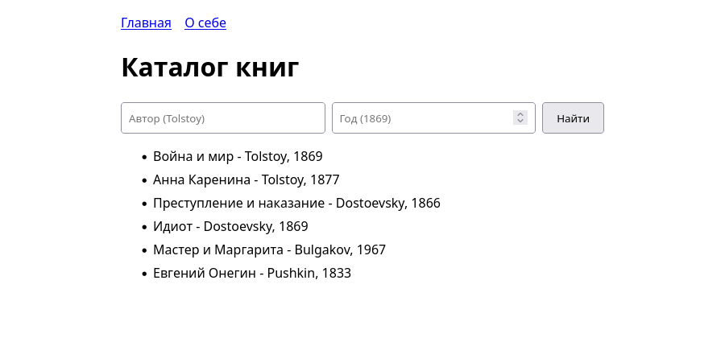
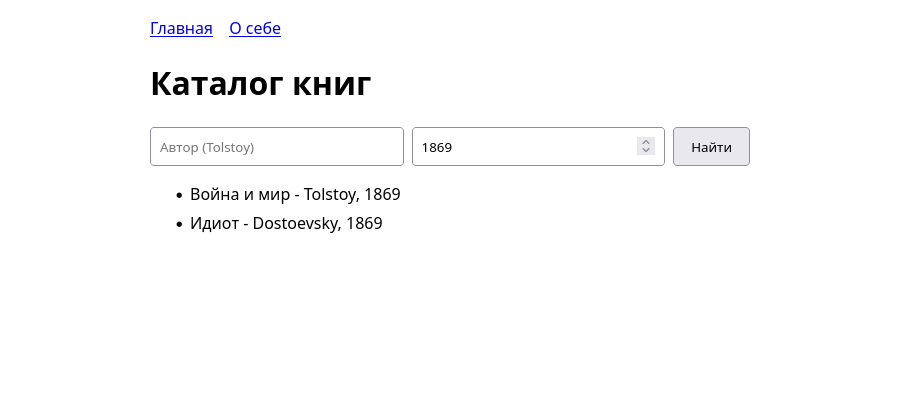
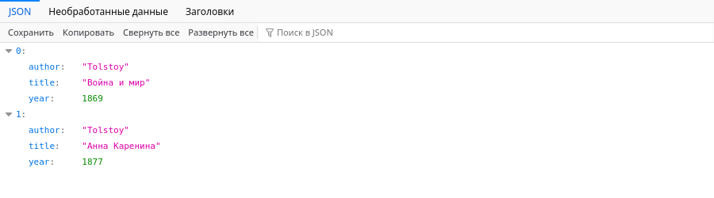
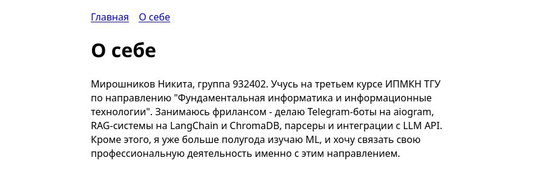

# Лабораторная работа №6 — «Каталог книг»

> Небольшое веб-приложение, которое устанавливается, работает без интернета и умеет искать книги по автору и году.

**Студент:** Никита Мирошников · **Группа:** 932402 · **Вариант:** 9

## Что сделано

Каталог книг на тему варианта №9 — «Каталог книг (поиск и фильтрация)»:

- сервер с маршрутами `/`, `/about` и `/api/books`;
- фильтрация списка по автору (`?author=Tolstoy`) и году (`?year=1869`), без параметров отдаются все книги, пустой результат — `[]`;
- страница с формой поиска, которая обращается к API без перезагрузки;
- **PWA**: манифест с иконками, установка на устройство и работа офлайн через service worker.

## Как сделано

| Часть | Реализация |
|---|---|
| Сервер | Python 3 + Flask, статика из папки `public/` |
| API | `GET /api/books` — фильтры по `author` (без учёта регистра) и `year`, ответ в JSON |
| Клиент | HTML + CSS + JS (`fetch`, `async/await`, `URLSearchParams`) |
| Манифест | `manifest.json`: название, `standalone`, цвет темы, иконки 192×192 и 512×512 |
| Service worker | `sw.js`: при установке кладёт статику в кеш, для `/api/*` — «сеть, при её отсутствии кеш», для остального — «кеш, потом сеть»; старые версии кеша удаляются при активации |

Структура:

```
app.py            # сервер и API
public/
  index.html      # главная с поиском
  about.html      # страница «О себе»
  app.js          # запросы к API + регистрация SW
  sw.js           # service worker
  manifest.json   # манифест PWA
  icons/          # иконки приложения
```

## Что получилось

**Главная: все книги.** Без фильтров показан весь каталог.



**Фильтр по автору** (`?author=Tolstoy`):


**Фильтр по году** (`?year=1869`):



**JSON-ответ API:**



**Страница «О себе»:**



Результат: после первой загрузки сайт кешируется и открывается без сети, а в браузере доступна установка как приложения.

## Запуск

```bash
python -m venv venv
source venv/bin/activate        # Windows: venv\Scripts\activate
pip install -r requirements.txt
python app.py
```

Открыть http://localhost:3000. Примеры API:

```bash
curl "http://localhost:3000/api/books"
curl "http://localhost:3000/api/books?author=Tolstoy"
curl "http://localhost:3000/api/books?year=1869"
```
